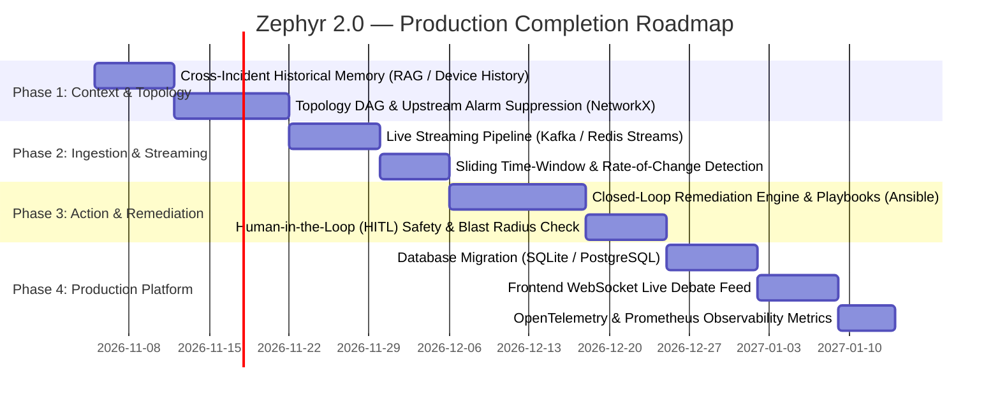

# NetCoop AI / Zephyr 2.0 — Comprehensive Project Documentation

---

## 1. Executive Summary & Problem Statement

### 1.1. Context & Purpose
**NetCoop AI / Zephyr 2.0** is an autonomous, neuro-symbolic, multi-agent network fault correlation and diagnostic system. It is designed to ingest high-frequency telemetry from complex enterprise and campus networks, detect anomalies across physical, link, network, and application layers, and conduct an adversarial consensus debate to isolate true root causes within seconds.

### 1.2. The Problem It Solves
Modern network infrastructures (such as university campuses, data centers, and multi-tenant enterprise networks) generate thousands of telemetry metrics per second. When an anomaly occurs, operators face three critical challenges:
1. **Alert Fatigue & Noise**: A single upstream fiber bend triggers cascade alarms across dozens of downstream access switches, Wi-Fi access points, and core services. Traditional rule-based NMS (Network Management Systems) produce alert storms with false positives.
2. **Control-Plane & Prompt Bias in LLMs**: Direct monolithic prompting of Large Language Models (LLMs) on raw telemetry fails. Generic LLMs hallucinate, suffer from recency bias, mistake secondary symptoms (e.g., latency caused by packet loss) for root causes, and lack domain grounding.
3. **Consensus Gridlock in Multi-Agent Debates**: When multiple agents vote using simple majority voting, healthy domains (e.g., DNS and DHCP) out-vote a single failing domain (e.g., physical fiber degradation), leading to erroneous diagnosis.

### 1.3. Zephyr 2.0's Architectural Solution
Zephyr 2.0 solves this by combining **first-principles fuzzy logic pre-filtering** with an **adversarial, domain-specialized debate protocol** governed by **Dynamic Severity Multipliers**:
* Edge telemetry is pre-filtered by domain sensors using Triangular Membership Functions (TRIMF), stripping baseline noise and computing continuous anomaly weights.
* A central **Brain Reasoning Engine** generates candidate hypotheses.
* Specialized, skeptical **Domain Voter Agents** (Infrastructure, Traffic, L4–L7 Services) evaluate hypotheses against ground truth local metrics.
* Inter-agent communication is strictly validated by **Coordination Middleware** using Pydantic schemas.
* The **Consensus Iterator** weighs votes according to anomaly severity—ensuring catastrophic physical failures mathematically override minor traffic symptoms.

---

## 2. System Architecture & Multi-Agent Workflow

```
[Raw Network Telemetry Stream]
             │
             ├──► [StateStore (core/shared_state.py)] (Thread-Safe In-Memory Cache)
             │
             ▼
[Edge Neuro-Symbolic Fuzzy Sensors]
 ├── InfrastructureSensor (L1/L2 Hardware & Physical)
 ├── TrafficSensor        (L3 Bandwidth, Congestion, Latency, Loss)
 └── L4L7Sensor           (L4/L7 DNS, DHCP, Core Services)
             │ (Discards 'Healthy' Noise / Emits Anomaly Scores & Evidence)
             ▼
[Active Alerts Batch Router]
             │
             ▼
╔══════════════════════════════════════════════════════════════════╗
║               CENTRAL BRAIN CONVERSATION LOOP                    ║
║                                                                  ║
║  1. Brain Reasoning Engine (agents/brain/reasoner.py)            ║
║     - Ingests alerts + previous round feedback                   ║
║     - Proposes hypothesis via Qwen 14B or Symbolic Fallback      ║
║                                                                  ║
║  2. Adversarial Domain Voters (agents/voters/llm_voter.py)       ║
║     - Infrastructure Voter (Hardware CRC, drops, CPU)            ║
║     - Traffic Voter        (Saturation, jitter, loss)            ║
║     - L4/L7 Voter          (DNS latency, DHCP pool)              ║
║                                                                  ║
║  3. Coordination Middleware (core/middleware.py)                 ║
║     - Enforces AgentVoteSchema; intercepts malformed outputs     ║
║                                                                  ║
║  4. Dynamic Severity Consensus Engine (agents/brain/iterator.py) ║
║     - Weighted confidence: Anomaly Score -> Voting Multiplier    ║
║     - Threshold >= 0.70 -> Consensus Reached (Break)             ║
║     - Threshold < 0.70  -> Inject Pivot Hint -> Round 2 / 3      ║
╚══════════════════════════════════════════════════════════════════╝
             │
             ├──► [IncidentMemory (core/memory.py)] (data/incident_memory.json)
             │
             └──► [Output Storage (core/output_store.py)] (output.json & outputs/{id}.json)
```

---

## 3. What Has Been Implemented (Done Till Now)

The following components and capabilities are fully implemented, tested, and operational in the codebase:

### 3.1. Neuro-Symbolic Fuzzy Sensor Pipeline
* **Triangular Membership Functions (TRIMF)** in [`core/fuzzy.py`](file:///d:/zephyr2/zephyr2.0/core/fuzzy.py):
  * Continuous fuzzification across `Normal`, `Warning`, and `Critical` parameter boundaries.
  * Replaces rigid if-else thresholds with continuous mathematical membership degrees ($\mu \in [0.0, 1.0]$).
* **Domain Sensors** in [`agents/infrastructure/sensor.py`](file:///d:/zephyr2/zephyr2.0/agents/infrastructure/sensor.py), [`agents/traffic/sensor.py`](file:///d:/zephyr2/zephyr2.0/agents/traffic/sensor.py), and [`agents/l4_l7/sensor.py`](file:///d:/zephyr2/zephyr2.0/agents/l4_l7/sensor.py):
  * Ingests telemetry dictionaries with strict type casting and error handling.
  * Discards benign background noise before any LLM is called (saving tokens and latency).
  * Computes an `anomaly_score` (`0.0` to `3.0+`) that dictates downstream voting power.
* **Thread-Safe StateStore** in [`core/shared_state.py`](file:///d:/zephyr2/zephyr2.0/core/shared_state.py):
  * Manages thread-safe read/write caching of latest device telemetry per switch/router using `threading.Lock`.

### 3.2. Central Brain & Dual-Mode Reasoning Engine
* **Reasoning Engine** in [`agents/brain/reasoner.py`](file:///d:/zephyr2/zephyr2.0/agents/brain/reasoner.py):
  * **Primary Mode (LLM)**: Integrates with local/remote Ollama serving `qwen3:14b` with structured JSON output instructions.
  * **Fast Reachability Caching**: Implements a 15-second TTL health cache (`_is_ollama_online`) to prevent socket timeouts when the inference server is unreachable.
  * **Neuro-Symbolic Fallback Mode**: If Ollama is offline or generates invalid syntax, automatically executes `_correlate_symbolic_hypothesis()`—a deterministic correlation engine that resolves anomalies based on domain severity rankings without crashing.
  * **Pivot Hint Compliance**: Explicitly trained to obey `CRITICAL PIVOT HINT`s from domain voters during subsequent debate rounds.

### 3.3. Adversarial Domain Voter Agents
* **LLM Domain Voters** in [`agents/voters/llm_voter.py`](file:///d:/zephyr2/zephyr2.0/agents/voters/llm_voter.py):
  * Persona-isolated agents: `infrastructure_agent`, `traffic_agent`, and `l4_l7_agent`.
  * Evaluates Brain hypotheses strictly against ground-truth domain telemetry.
  * Emits structured decisions: `APPROVE`, `REJECT`, or `ABSTAIN`.
  * Generates actionable feedback, suggested alternatives, and directional `pivot_hint`s when rejecting false hypotheses.
  * Dual-mode resilience: Has both LLM-prompted evaluation and deterministic heuristic fallback evaluation.

### 3.4. Coordination Middleware & Semantic Firewall
* **Middleware Engine** in [`core/middleware.py`](file:///d:/zephyr2/zephyr2.0/core/middleware.py):
  * Powered by Pydantic v2 `BaseModel` (`AgentVoteSchema`).
  * Validates every vote payload before passing it to the consensus iterator.
  * Intercepts malformed schemas, missing fields, or conversational markdown, converting them into safe fallback `ABSTAIN` responses to eliminate consensus crashes.

### 3.5. Dynamic Severity Consensus Math
* **Async Consensus Iterator** in [`agents/brain/iterator.py`](file:///d:/zephyr2/zephyr2.0/agents/brain/iterator.py):
  * Orchestrates iterative multi-epoch debates (up to 3 rounds).
  * **Dynamic Severity Multiplier Math**: Maps sensor anomaly scores directly to voter voting weights ($W_{\text{agent}} = \max(\text{anomaly\_score})$):
    * `FATAL` anomaly ($W \ge 3.0$)
    * `CRITICAL` anomaly ($2.0 \le W < 3.0$)
    * `MAJOR` anomaly ($1.0 \le W < 2.0$)
    * `MINOR` anomaly ($0.0 < W < 1.0$)
    * `HEALTHY` domain ($W = 0.0 \rightarrow \text{ABSTAIN}$)
  * Calculates weighted confidence:
    $$\text{Confidence} = \frac{\sum_{\text{APPROVE}} W_i}{\sum_{\text{APPROVE}} W_i + \sum_{\text{REJECT}} W_i}$$
  * Automatic early termination once confidence reaches $\ge 0.70$.
  * Generates actionable recommendations and limitations metadata.

### 3.6. Persistence & Native Output Archival
* **Persistent Memory Store** in [`core/memory.py`](file:///d:/zephyr2/zephyr2.0/core/memory.py):
  * Thread-safe, disk-backed memory stored at `data/incident_memory.json`.
  * Auto-loads historical incidents on process startup.
  * Uses atomic `.tmp` file writing and `os.replace` to prevent corrupted JSON on sudden termination.
  * Separates active debate rounds from permanent historical archives upon resolution (`clear_incident(archive=True)`).
* **Native Output Engine** in [`core/output_store.py`](file:///d:/zephyr2/zephyr2.0/core/output_store.py):
  * Saves generated diagnostic reports to `output.json` in the exact format as printed on the console.
  * Stores individual incident reports in `outputs/{incident_id}.json`.
  * Supports batch appending for multi-scenario test runs.

### 3.7. Benchmarking Dataset & Evaluation Harness
* **50-Scenario Benchmark Generator** in [`tests/generate-telemetry.py`](file:///d:/zephyr2/zephyr2.0/tests/generate-telemetry.py):
  * Programmatic generator covering 50 discrete network failure profiles (IIT Bhubaneswar campus topology).
* **Empirical Evaluator** in [`evaluator.py`](file:///d:/zephyr2/zephyr2.0/evaluator.py):
  * Systematically executes the complete agentic pipeline across benchmark datasets.
  * Measures accuracy, epoch convergence count, and latency, writing outputs to `evaluation_results.jsonl`.
* **Complete Automated Test Suites** in [`tests/`](file:///d:/zephyr2/zephyr2.0/tests/):
  * `test_fuzzy.py`: Validates membership functions and noise rejection.
  * `test_persistence.py`: Validates process-restart recovery and output parity.
  * `test_memory.py`: Validates round context building and vote tracking.
  * `test_infrastructure.py`, `test_traffic.py`, `test_l4_l7.py`, `test_llm_voter.py`, `test_reasoner.py`, `test_brain.py`.

---

## 4. Supported Network Fault Taxonomy (The 50 Benchmark Scenarios)

The system currently detects, evaluates, and isolates 50 distinct real-world fault categories across 6 domains:

| Category | Typical Scenarios Implemented | Primary Monitored Metrics |
| :--- | :--- | :--- |
| **1. Physical & L1 Hardware** | Cable damage, fiber optic bending, SFP transceiver failure, switch overheating closet, duplex mismatch, port flapping, dying ASIC, cable length attenuation, UPS dip reboot. | `interface_errors`, `packet_loss_pct`, `cpu_utilization_pct`, `queue_drops` |
| **2. L2 & Control Plane** | Broadcast storm, STP loop, MAC table flapping, MTU mismatch drops, VLAN trunk tag mismatch, 802.1X port security shutdown, ARP storm, UDLD error-disabled fiber, storm control threshold, STP recalculation jitter. | `cpu_utilization_pct`, `queue_drops`, `latency_ms`, `interface_errors` |
| **3. L3 & Traffic Congestion** | Hostel peak streaming congestion, ERP financial microbursts, BGP route flapping, dataset bulk transfers (AI Lab), 10G-to-1G uplink buffer bottleneck, asymmetric routing jitter, VoIP QoS queue drops, ICMP flooding, TCAM table exhaustion, multicast video flooding. | `link_utilization_pct`, `queue_drops`, `latency_ms`, `jitter_ms` |
| **4. Wireless & RF Access** | Rogue AP co-channel interference, weak signal cell fringe, high-density lecture auditorium congestion, microwave oven RF interference, sticky client low-rate airtime exhaustion, RADIUS server authentication timeout, beacon frame overhead, AP kernel memory leaks, DFS channel overlap radar drop, WLC controller disconnect. | `jitter_ms`, `packet_loss_pct`, `latency_ms`, `dhcp_pool_utilization_pct` |
| **5. L4/L7 Core Services** | DHCP pool exhaustion (/24 subnet depletion), authoritative DNS resolution timeout, NAT connection table exhaustion (firewall state drop), captive portal authentication server overload. | `dhcp_pool_utilization_pct`, `dns_latency_ms`, `cpu_utilization_pct` |
| **6. Edge Cases & Malformed Telemetry** | Missing metric keys (e.g. legacy SNMP switch without CPU data), corrupt non-numeric types (`"NaN"`, `None`), NTP clock sync drift (telemetry 2 hours old), compound simultaneous faults (e.g., SFP CRC errors + DHCP exhaustion), elevated healthy daytime baselines. | Schema validation, type sanitization, compound evidence handling |

---

## 5. Remaining Work & Implementation Roadmap (To Complete the Project)

To transition Zephyr 2.0 from an empirical prototype into an enterprise-grade, production-deployed autonomous NOC system, the following items remain to be implemented:



### 5.1. Priority 1: Cross-Incident Historical Memory (Device Recurrence & Few-Shot RAG)
* **Current State**: `data/incident_memory.json` persists past incidents to disk, but every new incident starts with `"No previous rounds. This is Round 1."` Past solved cases are not fed into new inferences.
* **To Implement**:
  1. **Device Recurrence Injection**: Implement `get_device_history(device_id)` in [`core/memory.py`](file:///d:/zephyr2/zephyr2.0/core/memory.py) to extract the last 3 resolved incidents for a switch and inject them into Round 1:
     > *"Notice: SW_CAMPUS_14 experienced 2 confirmed 'L1 Cable Degradation' events in the last 72h. Weight physical interface checks higher."*
  2. **Few-Shot Incident RAG**: Embed past diagnosed incidents (telemetry vector + confirmed diagnosis) into a lightweight vector store (e.g. ChromaDB / SQLite FTS5). When a new alert arrives, retrieve the top 2 matching historical cases and provide them as few-shot examples in the Reasoner prompt, accelerating consensus to Round 1.

### 5.2. Priority 2: Network Topology Graph & Alarm Suppression
* **Current State**: Incidents are partitioned solely by `device_id`. In real outages, a core switch failure triggers cascade symptoms across 30 child access switches and 80 APs, causing 111 independent debate loops.
* **To Implement**:
  1. Construct a Directed Acyclic Graph (DAG) using `NetworkX` representing the physical and logical network topology (Core Router $\rightarrow$ Distribution Switch $\rightarrow$ Access Switch $\rightarrow$ AP).
  2. Implement **Parent-Child Alarm Suppression**: If parent node $P$ exhibits fatal anomalies, suppress downstream alerts on child nodes $C_1, \dots, C_n$, cluster them as secondary symptoms, and execute a single root-cause debate for $P$.

### 5.3. Priority 3: Real-Time Streaming Ingestion Pipeline
* **Current State**: Ingestion is triggered via programmatic script execution (`main.py`, `stress_test_shi.py`, `evaluator.py`).
* **To Implement**:
  1. **Message Broker Consumer**: Build a daemon consumer for **Kafka / Redis Streams / MQTT / Webhooks** that continuously ingests streaming NetFlow, sFlow, and SNMP trap payloads.
  2. **Backpressure & Concurrency Throttling**: Implement an asynchronous queue with leaky-bucket rate limiting to protect local LLM GPU VRAM during massive broadcast storms.

### 5.4. Priority 4: Sliding Time-Window & Rate-of-Change Detection
* **Current State**: Sensors analyze instantaneous metric snapshots.
* **To Implement**:
  1. Maintain a rolling 5-minute sliding window per device in `StateStore`.
  2. Compute **Rate of Change ($\frac{\Delta \text{metric}}{\Delta t}$)** and **Exponential Moving Averages (EMA)** to differentiate transient single-second spikes (e.g. a momentary file transfer) from sustained link saturation.

### 5.5. Priority 5: Closed-Loop Automated Remediation & Human-in-the-Loop (HITL)
* **Current State**: The system generates human-readable advisory strings (e.g., `["Inspect optical patch cable", "Review QoS configuration"]`).
* **To Implement**:
  1. **Executable Playbook Catalog**: Define machine-executable remediation playbooks:
     * `RESET_PORT(switch_ip, port_id)`
     * `APPLY_ACL_RATE_LIMIT(switch_ip, vlan_id, rate_mbps)`
     * `FLUSH_DHCP_LEASES(server_ip, scope)`
     * `RESTART_CONTAINER_SERVICE(host, service_name)`
  2. **Safety Verification & Blast Radius Calculation**: Calculate the blast radius of proposed actions. High-risk actions (e.g. core link re-routing) generate a pending verification request.
  3. **Human Approval Gateway**: Provide a verification webhook/UI button for network engineers before executing modifying commands, with automatic rollback if health checks fail within 120 seconds.

### 5.6. Priority 6: Production Database Migration
* **Current State**: Memory and outputs use flat JSON files (`data/incident_memory.json`, `output.json`) guarded by Python threading locks.
* **To Implement**:
  1. In multi-worker production deployments (e.g., Gunicorn/Uvicorn with multiple workers), threading locks cannot synchronize between separate OS processes.
  2. Migrate persistence to **PostgreSQL** (with SQLAlchemy async) or **Redis**, enabling concurrent worker access, sub-millisecond indexed queries, and automated TTL eviction for older resolved incidents.

### 5.7. Priority 7: Frontend Integration & Live WebSocket Feed
* **Current State**: The repository contains the Python backend, while a Next.js frontend exists in `zephyr-frontend-final/project-zephyr-starter`.
* **To Implement**:
  1. Expose a FastAPI REST & WebSocket endpoint (`/api/v1/ws/debates`).
  2. Stream real-time agent turns, hypothesis broadcasts, voter justifications, and consensus confidence graphs live to the frontend dashboard.

### 5.8. Priority 8: Production Observability & OpenTelemetry
* **To Implement**:
  1. Instrument all agent turns, LLM latencies, and consensus calculations with **OpenTelemetry** spans.
  2. Expose a Prometheus `/metrics` endpoint exporting:
     * `netcoop_consensus_rounds_total`
     * `netcoop_agent_agreement_ratio`
     * `netcoop_llm_inference_duration_seconds`
     * `netcoop_incidents_diagnosed_total`

---

## 6. Current Implementation vs. Final Target Comparison

| Architectural Dimension | Current Status (Done Till Now) | Target Production Status (To Complete) |
| :--- | :--- | :--- |
| **Telemetry Ingestion** | Instantaneous JSON snapshot evaluation. | Continuous Kafka/Redis streaming with sliding window rate-of-change ($\Delta M/\Delta t$). |
| **Telemetry Filtering** | Triangular Fuzzy Membership Functions (TRIMF) with continuous anomaly scoring. | Adaptive, baseline-learning fuzzy boundaries based on rolling historical percentiles (P95/P99). |
| **Network Correlation** | Per-device incident grouping; sequential batch queuing. | Topology-aware DAG (NetworkX) with parent-child cascade suppression. |
| **Reasoning Engine** | Qwen 14B via Ollama + deterministic symbolic fallback. | Multi-tier LLM gateway (Local Ollama $\rightarrow$ Cloud Gemini/Claude fallback $\rightarrow$ Symbolic rulebook). |
| **Domain Voters** | 3 specialized LLM agents (Infra, Traffic, L4–L7) with ground-truth metric isolation. | Expanded catalog (+ Wireless/RF agent, + Security/Firewall agent) with calibrated voting weights. |
| **Middleware & Safety** | Pydantic v2 validation intercepting malformed LLM outputs. | Semantic schema validation + automated semantic drift detection and token guardrails. |
| **Consensus Mechanism** | Dynamic Severity Multipliers with early threshold convergence ($\ge 0.70$). | Dynamic Severity Multipliers combined with Bayesian prior updates from verified historical resolutions. |
| **Incident Memory** | Thread-safe, disk-backed persistence (`incident_memory.json`). | Distributed PostgreSQL/Redis store with device recurrence injection and Few-Shot RAG. |
| **Remediation** | Advisory text recommendations in final report. | Executable closed-loop playbooks (Netmiko/Ansible) with blast-radius checks and Human-in-the-Loop gates. |
| **Reporting & Export** | Native JSON output files (`output.json`, `outputs/{id}.json`). | Real-time WebSocket streaming to Next.js UI + Prometheus/OpenTelemetry metrics. |

---

## 7. Technology Stack Summary

* **Core Programming Language**: Python 3.12+ (AsyncIO, type annotations)
* **Fuzzy Logic & Math**: Custom first-principles Triangular Membership Engine (`core/fuzzy.py`)
* **LLM Engine**: Ollama Daemon (`qwen3:14b` / `qwen2.5:7b-instruct`) with streaming HTTP client
* **Schema Validation & Middleware**: Pydantic v2 (`BaseModel`, `Field`, `ValidationError`)
* **State & Memory Management**: Mutex-locked in-memory stores (`threading.Lock`) with atomic `.tmp` disk serialization
* **Testing & Benchmarking Framework**: Custom empirical evaluation suite (`evaluator.py`, `tests/generate-telemetry.py`) covering 50 discrete fault scenarios
* **Planned Production Additions**: FastAPI, NetworkX, Redis Streams, PostgreSQL, OpenTelemetry, Ansible/Netmiko
