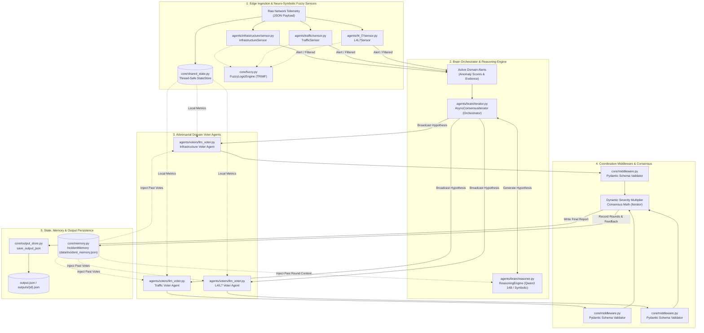
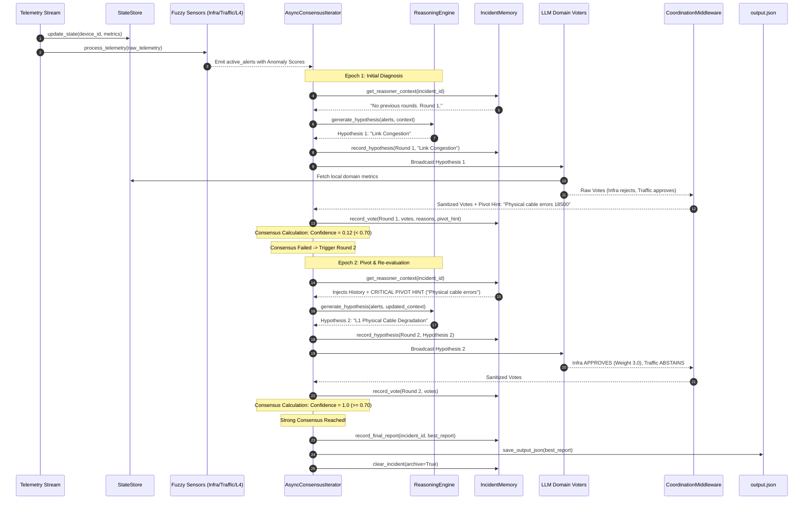

# Zephyr 2.0 (NetCoop AI) — Autonomous Multi-Agent Network Diagnostic Architecture

## 1. Executive Summary

**Zephyr 2.0 (NetCoop AI)** is a resilient, neuro-symbolic multi-agent consensus system designed for autonomous fault isolation and root-cause diagnosis in complex campus networks.

Traditional network diagnostic systems rely either on brittle, static threshold rules or on monolithic LLM prompts that suffer from hallucinations, high latency, and control-plane bias. Zephyr 2.0 resolves these challenges by introducing a **decentralized, adversarial debate architecture**:

1. **Fuzzy Edge Sensors** pre-filter raw telemetry using triangular membership functions (TRIMF) to strip baseline noise and assign continuous anomaly weights.
2. A central **Brain Orchestrator & Reasoning Engine** formulates candidate root-cause hypotheses using LLMs (Qwen 14B) with deterministic symbolic correlation fallbacks.
3. Skeptical, domain-isolated **LLM Voter Agents** (Infrastructure, Traffic, L4–L7 Services) evaluate hypotheses against local ground-truth metrics.
4. An inter-agent **Coordination Middleware** validates all communication against strict Pydantic schemas, preventing semantic drift.
5. A **Dynamic Severity Consensus Engine** weighs votes proportionally to real-time anomaly severity, enabling catastrophic alerts to out-vote minor symptoms and prevent consensus gridlock.
6. A **Thread-Safe Persistent Memory** archives debate histories, hypotheses, and diagnostic outputs.

---

## 2. High-Level Architecture Diagram



---

## 3. Core Component Analysis & Agent Typologies

### 3.1. Telemetry Ingestion & Neuro-Symbolic Fuzzy Edge Sensors

* **Components**:
  * `InfrastructureSensor` (`zephyr2.0/agents/infrastructure/sensor.py`)
  * `TrafficSensor` (`zephyr2.0/agents/traffic/sensor.py`)
  * `L4L7Sensor` (`zephyr2.0/agents/l4_l7/sensor.py`)
  * `FuzzyLogicEngine` (`zephyr2.0/core/fuzzy.py`)
  * `StateStore` (`zephyr2.0/core/shared_state.py`)

* **Responsibilities**:
  1. **Telemetry Parsing & Type Sanitization**: Ingests incoming JSON telemetry containing interface statistics, CPU metrics, queue drops, latency, jitter, DNS timings, and DHCP pool states.
  2. **Thread-Safe State Synchronization**: Updates the global singleton `global_state` so voter agents have access to verified device metrics without passing raw payloads through prompts.
  3. **Fuzzification (TRIMF)**: Replaces rigid binary thresholds with Triangular Membership Functions:
     $$\mu(x; a, b, c) = \max\left(0, \min\left(\frac{x-a}{b-a}, \frac{c-x}{c-b}\right)\right)$$
     Metrics are classified into `Normal`, `Warning`, and `Critical` states with continuous membership degrees.
  4. **Noise Dropping**: Alerts with severity `healthy` are discarded immediately, saving downstream LLM tokens and execution latency.
  5. **Anomaly Score Emission**: Calculates a float `anomaly_score` (ranging from `0.0` to `3.0+`) that directly determines the voting power of that domain during the debate.

---

### 3.2. Central Brain: Reasoning Engine

* **Component**: `ReasoningEngine` (`zephyr2.0/agents/brain/reasoner.py`)
* **Model**: Local/Remote Ollama `qwen3:14b` with deterministic neuro-symbolic fallback.
* **Responsibilities**:
  1. **Hypothesis Formulation**: Aggregates filtered active alerts, device IDs, and previous round context to propose a root cause hypothesis, confidence estimate, and actionable remediation steps.
  2. **Critical Pivot Adherence**: In multi-epoch debates, if an adversarial voter agent emits a `CRITICAL PIVOT HINT` (e.g., *"Ignore traffic; this is Layer 1 cable degradation"*), the prompt forces the Reasoner to discard its previous hypothesis and pivot to the suggested domain.
  3. **Dual-Mode Fallback Resilience**: If the Ollama daemon is offline or returns unparseable markdown, the engine automatically switches to `_correlate_symbolic_hypothesis()`, which correlates alerts deterministically via domain severity sorting without crashing.

---

### 3.3. Adversarial Domain Voter Agents

* **Component**: `LLMDomainVoter` (`zephyr2.0/agents/voters/llm_voter.py`)
* **Agents Instantiated**:
  * `infrastructure_agent`: Monitors Layer 1/2 hardware (`cpu_utilization_pct`, `interface_errors`, `queue_drops`).
  * `traffic_agent`: Monitors Layer 3 traffic dynamics (`link_utilization_pct`, `latency_ms`, `packet_loss_pct`, `jitter_ms`).
  * `l4_l7_agent`: Monitors Layer 4/7 services (`dns_latency_ms`, `dhcp_pool_utilization_pct`).
* **Responsibilities & Skeptic Logic**:
  1. **Strict Domain Isolation**: An agent only evaluates hypotheses against its own monitored metrics. It explicitly rejects root-cause claims that falsely implicate its domain.
  2. **Adversarial Voting Tree**:
     * `APPROVE`: The hypothesis describes root-cause symptoms that match local anomalous metrics.
     * `REJECT`: The agent's local metrics prove the hypothesis mathematically impossible, or the hypothesis mistakes a secondary symptom for a root cause.
     * `ABSTAIN`: The metrics are normal and the hypothesis falls outside the agent's domain.
  3. **Pivot Hint Generation**: When rejecting a hypothesis, the voter generates a concrete `pivot_hint` guiding the Brain toward the true fault domain.

---

### 3.4. Coordination Middleware & Semantic Firewall

* **Component**: `CoordinationMiddleware` (`zephyr2.0/core/middleware.py`)
* **Responsibilities**:
  1. **Schema Validation**: Validates all agent votes against the Pydantic schema `AgentVoteSchema`.
  2. **Crash & Drift Prevention**: If an LLM hallucinates non-standard keys or conversational text instead of strict JSON, the middleware intercepts the error and returns a sanitized fallback payload:
     ```python
     {
         "vote": "ABSTAIN",
         "reason": "Middleware intercept: Agent generated malformed JSON schema.",
         "suggested_alternative": None,
         "supporting_evidence": []
     }
     ```
     This prevents corrupt payloads from reaching the consensus engine.

---

### 3.5. Consensus Orchestrator: AsyncConsensusIterator

* **Component**: `AsyncConsensusIterator` (`zephyr2.0/agents/brain/iterator.py`)
* **Responsibilities**:
  1. **Multi-Device Sequential Routing**: In `route_and_resolve_batch()`, groups alerts by `device_id` and processes incidents sequentially to protect local GPU VRAM.
  2. **Debate Epoch Orchestration**: Coordinates up to 3 iterative debate rounds between Reasoner and Voter agents.
  3. **Dynamic Severity Multiplier Math**:
     Rather than simple unweighted majority voting (which allows healthy domains to out-vote a single failing domain), Zephyr 2.0 maps sensor `anomaly_score`s directly to voter voting weights:
     $$W_{\text{agent}} = \max_{\text{alert} \in \text{Domain}} (\text{alert.anomaly\_score})$$
     $$\text{Confidence} = \frac{\sum_{\text{APPROVE}} W_i}{\sum_{\text{APPROVE}} W_i + \sum_{\text{REJECT}} W_i}$$
     * `FATAL` anomaly ($W \ge 3.0$)
     * `CRITICAL` anomaly ($2.0 \le W < 3.0$)
     * `MAJOR` anomaly ($1.0 \le W < 2.0$)
     * `MINOR` anomaly ($0.0 < W < 1.0$)
     * `HEALTHY` domain ($W = 0.0 \rightarrow \text{ABSTAIN}$)
  4. **Break Condition**: If confidence reaches $\ge 0.70$, debate concludes immediately. Otherwise, voter feedback is committed to memory and Round 2 commences.

---

### 3.6. Persistence & Audit Layer

* **Components**:
  * `IncidentMemory` (`zephyr2.0/core/memory.py`)
  * `output_store` (`zephyr2.0/core/output_store.py`)
* **Responsibilities**:
  1. **Disk-Backed Memory Store**: Saves multi-round debate states to `data/incident_memory.json` using mutex locks and atomic `.tmp` file replacement.
  2. **Clean Working State vs. Audit Archive**: When an incident finishes, `clear_incident()` purges active working rounds to prevent context bleed, while preserving a permanent archived record on disk.
  3. **Native JSON Output Export**: Exports the final report to `output.json` and `outputs/{incident_id}.json` in the exact format produced by the system.

---

## 4. Multi-Agent Debate & Resolution Sequence Diagram

The following sequence diagram illustrates an adversarial debate where an initial incorrect hypothesis is rejected, pivoted, and successfully resolved in Round 2:



---

## 5. Mathematical Consensus Model

Standard LLM consensus frameworks fail when majority voting is applied across heterogeneous domain sensors. For example, a physical fiber break causes:
* `InfrastructureSensor`: Interface Errors = 25,000 ($\rightarrow \text{FATAL Anomaly, Score} = 3.0$)
* `TrafficSensor`: Elevated Latency = 45 ms ($\rightarrow \text{MINOR Anomaly, Score} = 0.5$)
* `L4L7Sensor`: Normal DNS/DHCP ($\rightarrow \text{HEALTHY, Score} = 0.0$)

If the Brain incorrectly guesses *"Minor Latency Anomaly due to Traffic"*, an unweighted voting system could yield:
* Traffic: `APPROVE`
* L4/L7: `ABSTAIN` (or APPROVE)
* Infrastructure: `REJECT`
* **Result**: $50\%$ approval, masking a physical link failure.

### Zephyr 2.0 Dynamic Severity Multiplier
In Zephyr 2.0, voting power is proportional to the sensor's anomaly severity:

$$\text{Weight}(A_i) = \max_{m \in \text{Domain}(A_i)} (\text{TRIMF\_Score}(m))$$

$$\text{Confidence} = \frac{\sum_{i \in \text{APPROVE}} \text{Weight}(A_i)}{\sum_{i \in \text{APPROVE}} \text{Weight}(A_i) + \sum_{j \in \text{REJECT}} \text{Weight}(A_j)}$$

Under this model:
* Infrastructure `REJECT` weight = $3.0$
* Traffic `APPROVE` weight = $0.5$
* Confidence = $\frac{0.5}{0.5 + 3.0} = \mathbf{0.14}$ ($\rightarrow \text{Strong Rejection}$)

Hypothesis 1 is rejected, forcing the Brain to ingest the Infrastructure agent's pivot hint. When Hypothesis 2 proposes *"L1 Physical Cable Degradation"*:
* Infrastructure `APPROVE` weight = $3.0$
* Traffic `ABSTAIN` weight = $0.0$
* Confidence = $\frac{3.0}{3.0 + 0.0} = \mathbf{1.00}$ ($\rightarrow \text{Consensus Reached in Round 2}$).

---

## 6. Operational Failure Modes & Mitigations

| Failure Mode | Root Cause | Zephyr 2.0 Architectural Mitigation |
| :--- | :--- | :--- |
| **Hallucination Cascades** | LLM accepts incorrect hypotheses to be helpful. | **Adversarial Personas**: Voters are prompted to be strictly skeptical and reject any claim unsupported by their metrics. |
| **LLM Daemon Offline / OOM** | Local Ollama instance crashes or runs out of VRAM. | **Dual-Mode Neuro-Symbolic Fallback**: `ReasoningEngine` falls back to deterministic rule sorting via `_correlate_symbolic_hypothesis()`. |
| **Semantic Drift / Bad JSON** | LLM emits conversational markdown or unexpected keys. | **Coordination Middleware**: Pydantic validation intercepts malformed schemas and enforces safe `ABSTAIN` defaults. |
| **Consensus Gridlock** | Healthy domain agents dilute severe failure signals. | **Dynamic Severity Multipliers**: Catastrophic alerts ($3.0$) carry 6x the voting power of minor symptoms ($0.5$). |
| **State Bleed Across Outages** | Previous incident context corrupts subsequent debates. | **Archive-on-Clear**: Working rounds are cleared from active memory while permanently preserved in disk archives. |
| **Disk Corruption on Shutdown** | Power loss during incident memory disk writes. | **Atomic Writes**: Serializes to `.tmp` files first and executes atomic OS-level file replacements. |
